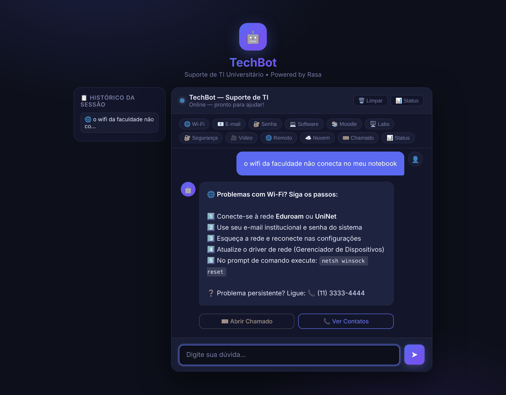
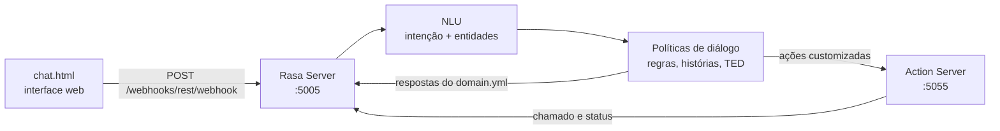

# TechBot — chatbot de suporte de TI com Rasa

Assistente virtual que responde às dúvidas de TI mais comuns de uma universidade (Wi-Fi, e-mail, senha, VPN, Moodle e outras), abre chamados por formulário e mostra o status dos sistemas. Feito com **Rasa Open Source** e processamento de linguagem natural em português.

Projeto acadêmico de Processamento de Linguagem Natural (PLN).



## O que ele faz

- **Entende a dúvida escrita do jeito que a pessoa fala.** "Não consigo conectar ao Wi-Fi", "minha internet está caindo" e "não aparece a rede" caem na mesma intenção.
- **Responde 19 tópicos de suporte**, cada um com passo a passo e botões para o próximo passo: Wi-Fi, e-mail, senha, softwares, impressora, Moodle, matrícula, portal do aluno, computador lento, VPN, antivírus, laboratórios, armazenamento em nuvem, segurança, celular, videoconferência, acesso remoto, contato e horários.
- **Abre chamado** com um formulário que pede nome, matrícula e descrição do problema, e devolve um número de protocolo.
- **Mostra o status dos sistemas** (portal, Moodle, e-mail, VPN e outros) por uma ação customizada.
- **Pede feedback** ao final e, se a resposta não ajudou, oferece abrir chamado ou falar com o suporte.
- **Reconhece o sistema operacional** citado na mensagem (Windows, macOS, Linux, Android, iOS) e normaliza variações como "win11" e "macbook".
- **Admite quando não entendeu**: abaixo de 30% de confiança, pede para reformular em vez de chutar.

## Como funciona



### Pipeline de NLU (`config.yml`)

| Etapa | Função |
| --- | --- |
| `WhitespaceTokenizer` | Separa a frase em palavras |
| `RegexFeaturizer` e `LexicalSyntacticFeaturizer` | Extraem padrões e características das palavras |
| `CountVectorsFeaturizer` (palavras) | Representa a frase pelo vocabulário |
| `CountVectorsFeaturizer` (`char_wb`, n-gramas de 1 a 4) | Tolera erros de digitação e variações de escrita, como "wi-fi" e "wifi" |
| `DIETClassifier` (100 épocas) | Classifica a intenção e extrai entidades ao mesmo tempo |
| `EntitySynonymMapper` | Normaliza sinônimos ("win11" → `windows`) |
| `FallbackClassifier` (limiar 0,3) | Cai no fallback quando a confiança é baixa ou ambígua |

### Diálogo

`RulePolicy` cuida das respostas diretas e do formulário de chamado; `MemoizationPolicy`, `TEDPolicy` e `UnexpecTEDIntentPolicy` aprendem com as histórias para conduzir conversas de várias etapas.

### Dados de treino

| | Quantidade |
| --- | --- |
| Intenções | 29 |
| Exemplos de frases | 347 (mínimo de 10 por intenção) |
| Regras | 31 |
| Histórias | 10 |
| Respostas | 31 |
| Entidade | `os_type`, com tabela de consulta e sinônimos |

## Estrutura

```
chat.html                  interface web do chat
requirements.txt
rasa_chatbot/
  config.yml               pipeline de NLU e políticas
  domain.yml               intenções, slots, formulário e respostas
  data/
    nlu.yml                exemplos de treino, entidades e sinônimos
    rules.yml              regras de resposta e do formulário
    stories.yml            conversas de exemplo
  actions/actions.py       abertura de chamado e status dos sistemas
  credentials.yml          canal REST
  endpoints.yml            endereço do action server
```

## Como rodar

Requer **Python 3.8 a 3.10** (o Rasa 3.6 não roda em versões mais novas).

```bash
python -m venv .venv
source .venv/bin/activate        # Windows: .venv\Scripts\activate
pip install -r requirements.txt

cd rasa_chatbot
rasa train
```

Depois, em dois terminais dentro de `rasa_chatbot/`:

```bash
# Terminal 1: servidor do Rasa com API liberada para a interface web
rasa run --enable-api --cors "*"

# Terminal 2: servidor das ações customizadas
rasa run actions
```

Abra o `chat.html` no navegador. Ele conversa com o Rasa em `http://localhost:5005`.

Para testar sem interface:

```bash
rasa shell        # conversa completa no terminal
rasa shell nlu    # mostra a intenção e a confiança de cada frase
rasa test         # avalia o modelo com os dados de treino
```

## Adicionando um tópico

1. Crie a intenção em `data/nlu.yml` com pelo menos 10 exemplos de frase.
2. Registre a intenção na lista `intents` do `domain.yml`.
3. Escreva a resposta `utter_<intenção>` no `domain.yml`.
4. Ligue as duas com uma regra em `data/rules.yml`.
5. Rode `rasa train` de novo.

## Limitações

- Os contatos, endereços e nomes de sistemas são **fictícios**, de uma universidade de exemplo.
- O status dos sistemas é **simulado**. Em produção, a ação consultaria uma ferramenta de monitoramento, como o Zabbix.
- O número do chamado é gerado na hora e não é gravado. Em produção, a ação abriria o chamado num sistema de helpdesk, como o GLPI.
